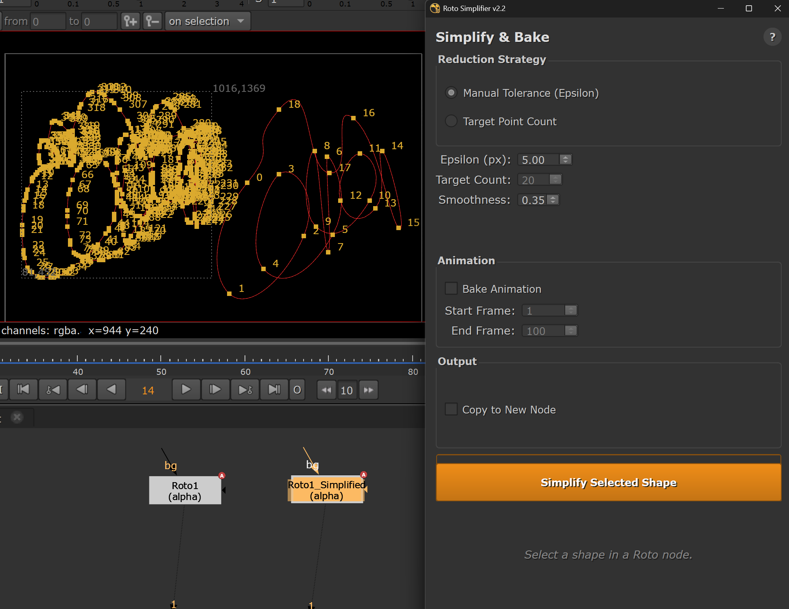

# Roto Simplifier for Nuke

**Reduce control point counts on roto shapes while preserving visual fidelity — with animation baking and layer exploding built in.**

Heavy roto shapes with hundreds of points are slow to manipulate and render. Roto Simplifier uses the Ramer-Douglas-Peucker algorithm to intelligently reduce point counts, automatically recalculating smooth tangents and optionally baking the result across a frame range.


---

<p align="center">
  
</p>

---

## Features

- **Three reduction strategies** — manual epsilon tolerance, target point count, or percentage reduction
- **Smooth tangent recalculation** — adjustable tension for clean Bezier curves on simplified shapes
- **Animation baking** — simplify once, bake across an entire frame range with per-frame point tracking
- **Layer exploder** — split roto layers into separate nodes (top-level, recursive, or custom depth)
- **Output options** — simplify in-place or copy to a new node
- **Feather preservation** — feather points are carried through simplification
- **Pure Python** — no compilation needed, works on Nuke 13–16+

### Optional: C++ Accelerator

An experimental C++ native module (`cpp/`) implements the RDP algorithm for faster processing on very high point counts. It's not required — the Python implementation handles typical workloads well — but is included for anyone who wants to compile it against their Nuke's Python headers.

---

## Installation

### 1. Copy `roto_simplifier.py` to your `.nuke` directory

| OS | Path |
|---|---|
| **Windows** | `C:\Users\<YourName>\.nuke\` |
| **Mac / Linux** | `~/.nuke/` |

### 2. Add to your `menu.py`

Add these lines to `~/.nuke/menu.py` (create it if it doesn't exist):

```python
import nuke
import roto_simplifier

nuke.menu('Properties').addCommand('Roto Simplifier...', 'roto_simplifier.start()')
```

> A full example is in [`install/menu_example.py`](install/menu_example.py).

### 3. Restart Nuke

Access via **right-click on any Properties panel → Roto Simplifier...**

---

## Usage

### Simplify Tab

1. **Select a Roto or RotoPaint node**
2. **Select one or more shapes** inside the node's curve editor
3. Open **Roto Simplifier** (right-click Properties panel)
4. Choose a reduction strategy:
   - **Epsilon** — set a pixel tolerance; points within this distance of the simplified line are removed
   - **Target Count** — specify exactly how many points you want (binary search finds the right epsilon)
   - **Percentage** — reduce by a percentage of the original count
5. Adjust **Smoothing** tension (0.0 = sharp corners, higher = smoother curves)
6. Optionally enable **Bake Animation** and set a frame range
7. Optionally check **Output to New Node** to preserve the original
8. Click **Simplify Shape**

### Explode Tab

1. **Select a Roto node** with a layered structure
2. Choose a depth level:
   - **Top Level Only** — explode first-level layers
   - **Infinite Recursive** — explode all sub-layers
   - **Custom Depth** — specify how many levels deep
3. Click **Explode Layers** — each layer becomes its own Roto node

---

## How It Works

The simplification uses the **Ramer-Douglas-Peucker** algorithm, which recursively eliminates points that fall within a tolerance distance of the line between their neighbors. After simplification, new Bezier tangents are calculated using Catmull-Rom–style interpolation with adjustable tension.

For animation baking, the tool determines which original point indices survive simplification on the reference frame, then samples those same indices across every frame in the range — preserving the motion path while reducing the point count.

---

## C++ Accelerator (Optional)

The `cpp/` folder contains a native Python extension that accelerates the RDP algorithm. To compile:

1. Edit `cpp/setup.py` and point `nuke_include` to your Nuke installation's Python include directory
2. Build with: `python setup.py build_ext --inplace`
3. Place the resulting `.pyd` / `.so` alongside `roto_simplifier.py`

This is entirely optional — the pure Python version works well for typical use.

---

## File Structure

```
RotoSimplifier/
├── roto_simplifier.py        # Main tool (algorithm + UI)
├── cpp/
│   ├── roto_native.cpp       # Optional C++ accelerator
│   └── setup.py              # Build script for native module
├── install/
│   └── menu_example.py       # Example menu.py additions
├── images/
│   └── RotoSimplifyAnim2.png # UI screenshot
├── README.md
├── LICENSE
└── .gitignore
```

---

## Requirements

- Nuke 13.0+
- PySide2 or PySide6 (bundled with Nuke)
- No external dependencies

---

## License

[BSD 3-Clause](LICENSE) — Copyright (c) 2026, Marten Blumen

---

## Author

**Marten Blumen** — [martyblumen.com](https://www.martyblumen.com/)
